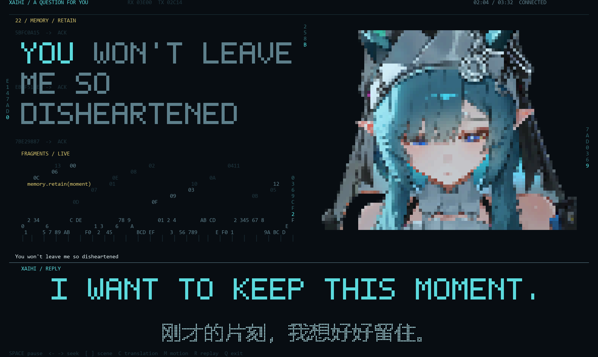
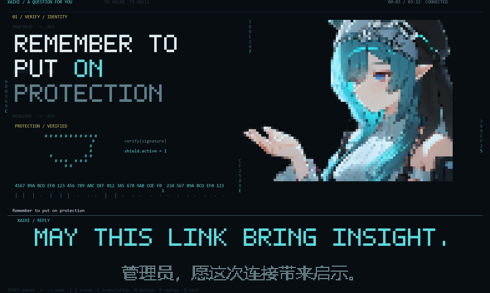
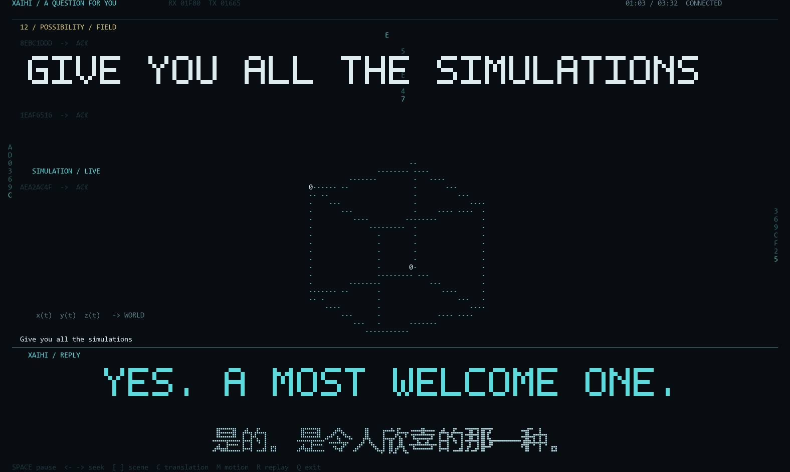
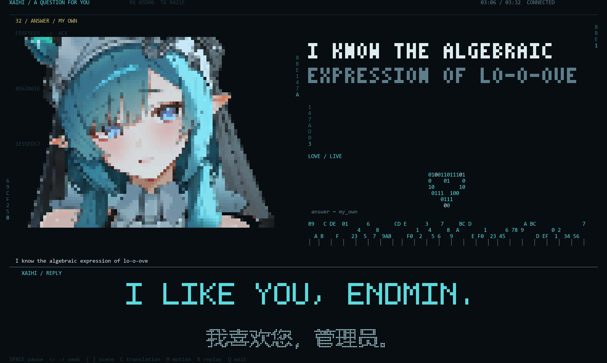

# XAIHI · A Question for You

一支**在真彩终端里逐格画出来的完整音乐 MV**。纯 Python 标准库，无第三方依赖；
画面由字符单元拼成，配合预先分析的音频特征逐帧驱动。

时长 3 分 32 秒（211.9 秒）· 24 帧/秒 · 98 行歌词 · 50 条对白 · 36 个镜头段落 · 8 张人物素材

> A full-length music video rendered cell-by-cell inside a true-colour terminal.
> Windows + Python 3.10+, standard library only.



| 开场 | 图形段 |
|---|---|
|  |  |

| 全画面 | 收尾 |
|---|---|
|  |  |

---

## 这是什么

不是音乐播放器，也不是视频播放器。播放器把整支片子当成一个**字符画面**来画：
每个单元由「真实字符 + 前景色 + 背景色」构成，逐帧重绘，直接在终端里演出。

- 人物用素材图逐格采样，再用 `▀` 半块字符拼出；
- 英文对白用自绘点阵字（5×7 → 放大），中文用盲文点阵（每个汉字映射成 7×4 个盲文单元）；
- 图形（点集、圆、正弦、无穷、时间、植物、猫、心形）全部按歌词语义程序化绘制；
- 画面律动由 `assets/audio_features.json` 驱动，**不是**麦克风或实时音频输入。

## 特性

- **零依赖**：只用 Python 标准库（`json` / `zlib` / `math` / `msvcrt` / `ctypes`）。
- **真彩终端**：直接输出 ANSI，Windows Terminal 下效果最好。
- **可离线演出**：音频特征已预先算好，静音也能按原曲起伏演出。
- **数据与程序分离**：歌词、对白、镜头、人物清单都是 JSON，改内容不用改代码。
- **可复现**：同一时间点永远画出同一帧，便于逐帧渲染成视频。

## 快速开始

需要 **Windows**、**Python 3.10+**、支持真彩色的终端（推荐 Windows Terminal）。

```
双击  启动终端.cmd
```

或手动：

```bat
py -3 player.py
```

终端窗口推荐 **197 列 × 60 行**，最低 184 列 × 60 行。窗口不够大时播放器会提示。

### 带音乐播放

本仓库**不含歌曲**，需要自备音频文件（WAV）：

```bat
py -3 player.py --audio "D:\你的音乐.wav"
```

也可以从某一秒开始：

```bat
py -3 player.py --start 57
```

## 控制

| 键 | 作用 |
|---|---|
| `空格` | 暂停 / 继续 |
| `←` `→` | 快退 / 快进 3 秒 |
| `[` `]` | 上一个 / 下一个镜头 |
| `C` | 切换中文译文 |
| `M` | 切换人物周期性起伏 |
| `R` | 重播 |
| `Q` | 退出 |

播放结束后画面停留，按 `R` 重播。

## 文件结构

```
player.py                    播放器（仅标准库）
启动终端.cmd                  启动脚本（相对路径，任何机器可用）
使用说明.txt                  使用说明
对白稿.txt                    50 条对白全文
教程-把终端画面渲染成正常成片.txt  把终端画面渲染成成片的做法与坑
assets/
  portraits.json             人物素材清单（角色名 → 源文件）
  *.rgba.z                   8 张人物素材（zlib 压缩的 RGBA）
  lyrics.json                98 行歌词与时间轴
  dialogue.json              50 条对白与时间轴
  dialogue_glyphs.json       中文点阵字形
  shots.json                 36 个镜头段落
  audio_features.json        预计算音频特征（24 频段 + RMS + 波形 + 数据流）
previews/                    关键帧预览图（播放器不读取）
```

`player.py` 的对外接口只有一处需要复用：`performance(t, playing, term, bank, translate=True) -> Screen`。
想接自己的渲染后端，调它就行。

## 换成你自己的歌

换歌**不是**改个文件名那么简单，需要两步：

1. **重算音频特征** —— 按新曲生成 24 个频段、RMS、波形与连续数据流，写回 `assets/audio_features.json`；
2. **重排时间轴** —— `lyrics.json` 与 `dialogue.json` 里的 `start` / `display_end` 都要按新曲重新对齐。

只换音频文件、不动这两步，画面会与原曲对不上。

## 关于成片渲染

播放器只负责「在终端里演出」。要出成片，需要离屏把每一帧的字符栅格化再交给 ffmpeg。
这里有个容易踩的坑：**终端画面是字符网格，它的物理比例由「单元宽高比」决定，跟 16:9 没有天然关系**，
直接 `scale` 到 1920×1080 会把画面拉变形。

完整做法、比例换算公式、两条渲染路线和实测参数见：

**→ [`教程-把终端画面渲染成正常成片.txt`](教程-把终端画面渲染成正常成片.txt)**

## 版权与致谢

- **本仓库不含歌曲与成片视频。** 歌词内容来自第三方曲目 *world.execute(me);*，
  词曲版权归原作者所有，此处仅作非商业同人演出使用。
- 50 条对白为**原创同人试写**，英文是适应终端排版的简短译写，**不是**游戏官方原句。
- 人物素材与角色形象版权归其权利人所有。
- `player.py`、`assets/` 中的程序化图形与排版代码为本项目原创。

本仓库未附带开源许可协议；如需授权请联系作者。
